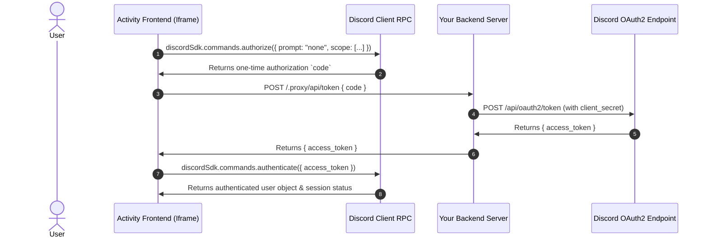

# Discord SDK Lifecycle and Authentication

This reference explains the complete initialization lifecycle, RPC handshake, and OAuth2 authentication flow for Discord Activities using `@discord/embedded-app-sdk`.

---

## 1. Installation & Environment

Install the official SDK:

```bash
npm install @discord/embedded-app-sdk
# or pnpm / yarn / bun
pnpm add @discord/embedded-app-sdk
```

---

## 2. Instantiation & RPC Handshake

When a Discord Activity loads, Discord embeds the web app inside an iframe, appending query parameters such as `frame_id`, `instance_id`, `channel_id`, and `platform`.

### Initialization Sequence

```typescript
import { DiscordSDK } from "@discord/embedded-app-sdk";

// 1. Instantiate SDK with your Discord Application Client ID
const discordSdk = new DiscordSDK(import.meta.env.VITE_DISCORD_CLIENT_ID);

export async function setupDiscordSdk() {
  // 2. Critical: Wait for the RPC handshake before calling any command!
  await discordSdk.ready();

  console.log("Discord SDK is ready!");
  console.log("Platform:", discordSdk.platform);     // "desktop" | "mobile" | "web"
  console.log("Channel ID:", discordSdk.channelId); // Active voice/text channel
  console.log("Guild ID:", discordSdk.guildId);     // Active server (or null in DMs)
  console.log("Instance ID:", discordSdk.instanceId); // Unique activity session ID
}
```

> [!IMPORTANT]
> Calling any SDK command (e.g. `authorize`, `subscribe`, `startPurchase`) before `await discordSdk.ready()` resolves will hang or throw an RPC error (`NotReadyError`).

---

## 3. The 3-Step Authentication Loop

To read the user's identity, avatar, guild membership, or voice state, you must authenticate the session with Discord:



### Step 1: Client Calls `authorize`

```typescript
const { code } = await discordSdk.commands.authorize({
  client_id: import.meta.env.VITE_DISCORD_CLIENT_ID,
  response_type: "code",
  state: "",
  prompt: "none", // "none" silently grants if user previously authorized the app
  scope: [
    "identify",
    "guilds",
    "guilds.members.read"
  ],
});
```

### Step 2: Client Sends Code to Backend via Proxy

```typescript
// Always route via /.proxy/ to comply with Discord CSP
const response = await fetch("/.proxy/api/token", {
  method: "POST",
  headers: { "Content-Type": "application/json" },
  body: JSON.stringify({ code }),
});

if (!response.ok) {
  throw new Error(`Token exchange failed: ${response.statusText}`);
}

const { access_token } = await response.json();
```

### Step 3: Client Finalizes `authenticate`

```typescript
const auth = await discordSdk.commands.authenticate({ access_token });

if (!auth) {
  throw new Error("Discord authentication failed");
}

console.log(`Successfully authenticated as: ${auth.user.username} (${auth.user.id})`);
```

---

## 4. Local Browser Mock Mode (Offline Development)

During early development or UI styling, running inside the real Discord desktop client is slow. You can detect whether the app is running inside Discord and provide a mock fallback:

```typescript
function isRunningInDiscord(): boolean {
  return typeof window !== "undefined" && window.location.search.includes("frame_id=");
}

export async function initializeApp() {
  if (!isRunningInDiscord()) {
    console.warn("⚠️ Running outside Discord. Activating local mock session.");
    return {
      user: {
        id: "1234567890",
        username: "LocalDevUser",
        discriminator: "0001",
        avatar: null,
      },
      channelId: "9999999999",
      guildId: "8888888888",
    };
  }

  // Real Discord flow
  await discordSdk.ready();
  const { code } = await discordSdk.commands.authorize({
    client_id: import.meta.env.VITE_DISCORD_CLIENT_ID,
    response_type: "code",
    state: "",
    prompt: "none",
    scope: ["identify", "guilds.members.read"],
  });

  const res = await fetch("/.proxy/api/token", {
    method: "POST",
    headers: { "Content-Type": "application/json" },
    body: JSON.stringify({ code }),
  });
  const { access_token } = await res.json();
  const auth = await discordSdk.commands.authenticate({ access_token });
  return auth;
}
```

---

## 5. Mobile Viewport & Platform Detection (`discordSdk.platform`)

Discord Activities run across **Desktop (Electron)**, **Web (Chrome/Firefox/Safari)**, and **Mobile (iOS & Android Discord app WebViews)**.

Inspect `discordSdk.platform` after `ready()`:

```typescript
console.log("Current platform:", discordSdk.platform); // "desktop" | "web" | "mobile"
```

### Mobile WebView Gotchas & CSS Fixes

On mobile devices, running inside the Discord WebView introduces three common traps:
1. **Dynamic URL/Address bar resizing**: Using `100vh` causes content to be cut off or jump when browser chrome toggles. Use `100dvh` or `100%`.
2. **Rubberband Bounce / Overscroll**: Swiping can accidentally drag the entire Discord Activity iframe or trigger parent page refresh. Add `overscroll-behavior: none;`.
3. **Double-tap Zoom & Touch Delays**: Mobile WebViews may delay tap events by 300ms. Set `touch-action: manipulation;`.

Recommended root CSS reset for Discord Activities:

```css
html, body {
  margin: 0;
  padding: 0;
  width: 100%;
  min-height: 100dvh;
  /* Prevent bounce & accidental frame scrolling on iOS / Android */
  overscroll-behavior: none;
  touch-action: manipulation;
  -webkit-touch-callout: none;
  -webkit-user-select: none;
  user-select: none;
  box-sizing: border-box;
}
```
