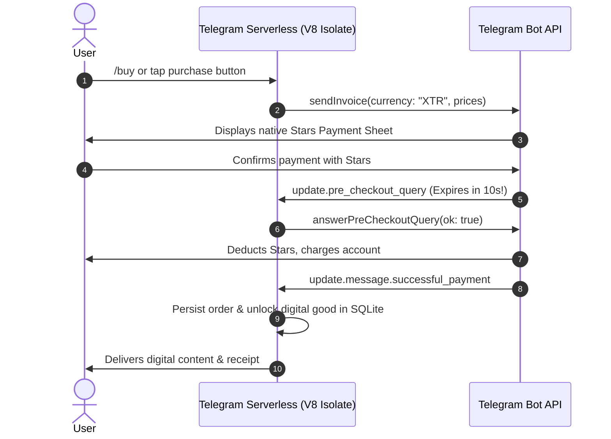

# Telegram Stars (XTR) Digital Payments

Telegram Stars (`XTR`) is Telegram's official currency for purchasing digital goods, subscriptions, and digital services inside bots and Mini Apps.

---

## 1. Stars Payment Architecture

A complete Stars payment flow consists of three distinct phases:



---

## 2. Step 1: Sending a Stars Invoice (`sendInvoice`)

> [!NOTE]
> Telegram Stars uses `currency: "XTR"`. Prices are specified in whole Stars (e.g. `amount: 50` = 50 Stars). No payment provider token is required for Stars payments.

```javascript
import api from "sdk/api";

export async function sendStarInvoice(chatId, item) {
  return api.sendInvoice(chatId, {
    title: item.title,                      // e.g. "Pro Membership (1 Month)"
    description: item.description,          // e.g. "Unlocks unlimited AI requests"
    payload: `order:${item.id}:${chatId}`,  // Internal tracking identifier
    currency: "XTR",                        // Telegram Stars currency code
    prices: [
      { label: item.title, amount: item.starsPrice } // 1 Star = 1 unit
    ]
  });
}
```

---

## 3. Step 2: Pre-Checkout Verification (`pre_checkout_query`)

> [!IMPORTANT]
> Telegram requires you to respond to `pre_checkout_query` within **10 seconds** by calling `api.answerPreCheckoutQuery`.
> If your isolate does not answer within 10s, Telegram cancels the transaction and refunds the user automatically.

```javascript
import api from "sdk/api";
import db from "sdk/db";

export async function handlePreCheckout(query) {
  const queryId = query.id;
  const payload = query.invoice_payload;
  const totalAmount = query.total_amount;

  // 1. Verify item availability or inventory if necessary
  const isValidOrder = payload.startsWith("order:");

  if (!isValidOrder) {
    return api.answerPreCheckoutQuery(queryId, {
      ok: false,
      error_message: "This product is currently out of stock or invalid."
    });
  }

  // 2. Approve payment immediately
  return api.answerPreCheckoutQuery(queryId, { ok: true });
}
```

---

## 4. Step 3: Fulfilling the Payment (`successful_payment`)

Once Telegram deducts the Stars, a message update containing `successful_payment` is dispatched to your bot:

```javascript
import api from "sdk/api";
import db from "sdk/db";

export async function handleSuccessfulPayment(msg) {
  const payment = msg.successful_payment;
  const chatId = msg.chat.id;
  const userId = msg.from.id;
  const chargeId = payment.telegram_payment_charge_id;
  const totalStars = payment.total_amount;
  const payload = payment.invoice_payload;

  // 1. Record order in SQLite to prevent duplicate fulfillment
  db.query(
    `INSERT INTO orders (charge_id, user_id, amount_stars, payload, status, created_at)
     VALUES (?, ?, ?, ?, 'completed', ?)`,
    [chargeId, userId, totalStars, payload, Math.floor(Date.now() / 1000)]
  );

  // 2. Grant digital entitlement (e.g. VIP status, credits)
  db.query(
    "UPDATE users SET credits = credits + ? WHERE user_id = ?",
    [totalStars * 10, userId]
  );

  // 3. Confirm receipt to user
  return api.sendMessage(
    chatId,
    `⭐ **Payment Confirmed!**\nThank you for purchasing with **${totalStars} Telegram Stars**.\nTransaction ID: \`${chargeId}\``,
    { parse_mode: "Markdown" }
  );
}
```

---

## 5. Refunding Telegram Stars

If a user requests a refund or an order cannot be completed:

```javascript
import api from "sdk/api";

export async function refundPayment(userId, chargeId) {
  return api.refundStarPayment(userId, chargeId);
}
```
