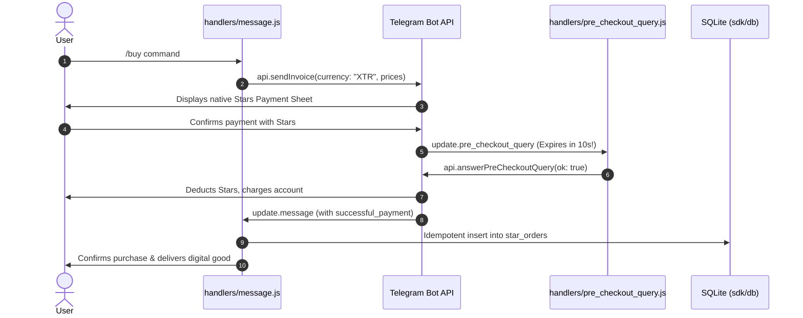

# Telegram Stars (XTR) Digital Payments

Telegram Stars (`XTR`) is Telegram's official currency for purchasing digital goods, subscriptions, and services inside bots and Mini Apps.

---

## 1. Stars Payment Architecture

A complete Stars payment flow spans two Telegram Serverless update handlers:



---

## 2. Step 1: Sending a Stars Invoice (`api.sendInvoice`)

> [!NOTE]
> Telegram Stars uses `currency: "XTR"`. Prices are whole integers (e.g. `amount: 50` = 50 Stars). No payment provider token is required for Stars payments (`provider_token` is omitted).

```javascript
import { api } from "sdk";

export async function sendStarInvoice(chatId, item) {
  return api.sendInvoice({
    chat_id: chatId,
    title: item.title,                      // e.g. "Pro Membership (1 Month)"
    description: item.description,          // e.g. "Unlocks priority bot features"
    payload: `order:${item.id}:${chatId}`,  // Internal tracking identifier
    currency: "XTR",                        // Telegram Stars currency code
    prices: [
      { label: item.title, amount: item.starsPrice } // 1 Star = 1 unit
    ]
  });
}
```

---

## 3. Step 2: Pre-Checkout Verification (`handlers/pre_checkout_query.js`)

> [!IMPORTANT]
> Telegram requires you to respond to `pre_checkout_query` within **10 seconds** by calling `api.answerPreCheckoutQuery`.
> If your isolate does not answer within 10s, Telegram cancels the transaction and refunds the user automatically.

```javascript
// tgcloud/handlers/pre_checkout_query.js
import { api } from "sdk";

export default async function (query, ctx) {
  const isValidOrder = typeof query.invoice_payload === "string" &&
    query.invoice_payload.startsWith("order:") &&
    query.currency === "XTR";

  if (!isValidOrder) {
    return api.answerPreCheckoutQuery({
      pre_checkout_query_id: query.id,
      ok: false,
      error_message: "This product is currently out of stock or invalid."
    });
  }

  // Approve payment immediately
  return api.answerPreCheckoutQuery({
    pre_checkout_query_id: query.id,
    ok: true
  });
}
```

---

## 4. Step 3: Fulfilling the Payment (`handlers/message.js`)

Once Telegram deducts the Stars, a message update containing `successful_payment` arrives:

```javascript
// tgcloud/handlers/message.js
import { api, db } from "sdk";
import { starOrders } from "../schema.js";

export default async function (message, ctx) {
  const chatId = message.chat.id;

  // 1. Handle completed Stars payment
  if (message.successful_payment) {
    const payment = message.successful_payment;
    const userId = message.from.id;
    const chargeId = payment.telegram_payment_charge_id;

    // Idempotent write: onConflictDoNothing ensures retries never double-credit
    const [claimed] = await db.insert(starOrders)
      .values({
        chargeId,
        userId,
        amountStars: payment.total_amount,
        productId: payment.invoice_payload,
        status: "paid",
      })
      .onConflictDoNothing()
      .returning()
      .run();

    if (claimed) {
      await api.sendMessage({
        chat_id: chatId,
        text: `⭐ **Payment Confirmed!**\nThank you for purchasing with **${payment.total_amount} Telegram Stars**.\nOrder ID: \`${chargeId}\``,
        parse_mode: "Markdown"
      });
    }
    return;
  }

  // 2. Handle /buy command
  if (message.text?.startsWith("/buy")) {
    await api.sendInvoice({
      chat_id: chatId,
      title: "⭐ Premium Pass (100 Stars)",
      description: "Unlock premium bot commands for 30 days.",
      payload: "order:premium_pass:1",
      currency: "XTR",
      prices: [{ label: "Premium Pass", amount: 100 }]
    });
  }
}
```

---

## 5. Refunding Telegram Stars

If an order cannot be delivered or a user requests a refund:

```javascript
import { api } from "sdk";

export async function refundPayment(userId, chargeId) {
  return api.refundStarPayment({
    user_id: userId,
    telegram_payment_charge_id: chargeId
  });
}
```
